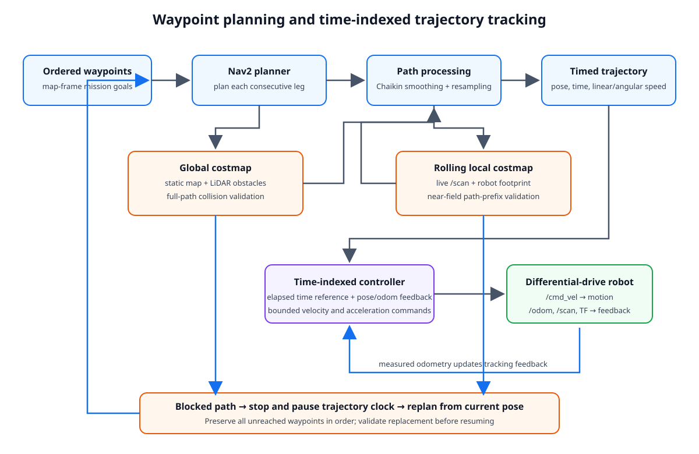
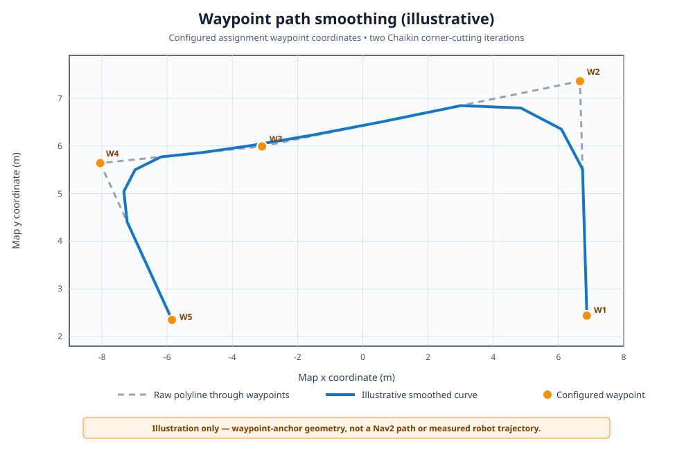
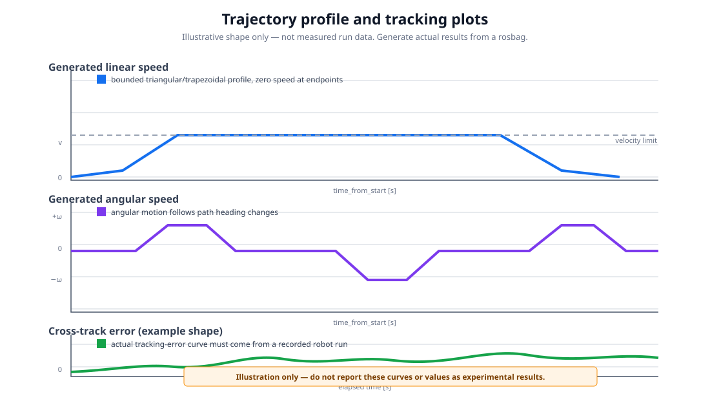

# Differential-Drive Path Smoothing and Trajectory Tracking

ROS 2 Humble assignment implementation for a simulated differential-drive robot. It plans through an ordered set of 2D waypoints, smooths and time-parameterizes the route, follows the trajectory using odometry feedback, and checks/replans around obstacles using Nav2 costmaps.

Gazebo startup and live local-costmap publication have been verified. The repository includes `demo_F.mp4`, which demonstrates the code walkthrough and dynamic-obstacle scenario in simulation. See the demonstration and verification notes below for the scope of the recorded evidence.


## Assignment deliverables

- Modular ROS 2 C++ implementation with a Gazebo robot simulation.
- Endpoint-preserving path smoothing and a timed trajectory controller.
- Separate map/localization and controller/planner launch files.
- Controller unit tests, a rosbag plotting script, and run instructions.
- Dynamic obstacle handling that stops, replans through the remaining ordered waypoints, validates the replacement path, and resumes timed tracking.

## Architecture



The assignment uses the standalone `trajectory_controller` launched by `custom_trajectory_control.launch.py`. It is not the Nav2 Controller Server plugin launch. The node requests Nav2 plans for each waypoint leg in order, joins the paths, smooths each leg while preserving the waypoint anchors, and creates a trajectory with position, heading, velocity, and monotonically increasing `time_from_start` samples. At each control cycle, elapsed trajectory time selects the reference; measured pose and odometry provide feedback. Commands respect configured velocity and acceleration limits, and the controller stops at the goal.

When a newly observed costmap obstacle intersects the remaining trajectory, the standalone controller stops and pauses its trajectory clock. It requests a new path from the current pose through the not-yet-reached waypoints in order, rejects paths that omit a remaining waypoint or fail collision checks, then smooths and regenerates a timed trajectory before resuming. Failed planning leaves the robot stopped for retry. The local rolling LiDAR map is launched with the custom controller and must be fresh; raw and smoothed paths are checked against both the global map and the local map's visible path prefix. This behavior is covered by unit/build tests. Gazebo startup and live local-costmap publication are verified, but a full obstacle-insertion/replanning run has not yet been recorded; see [Tests and verification status](#tests-and-verification-status).

### Design choices

- **Use Nav2 for grid planning, not trajectory tracking:** Nav2 handles map-based path planning; the assignment's standalone C++ node owns timed trajectory generation and `/cmd_vel`, avoiding a second active controller competing for velocity commands.
- **Preserve waypoint order:** plan each consecutive leg and retain every configured anchor during smoothing and dynamic replanning.
- **Smooth only after planning:** endpoint-preserving Chaikin smoothing with arc-length resampling softens corners. The controller validates the result against the costmaps and falls back to the unsmoothed planner route if needed.
- **Separate path geometry from timing:** create a speed profile with zero speed at endpoints, velocity/acceleration limits, and `time_from_start`; use pose and odometry feedback while following those timed references.
- **Fail safely on uncertain obstacle data:** stop when the global/local costmap is missing, stale, or shows a blocked part of the path. Pause trajectory time while stopped and only resume after a replacement route is validated.

## Workspace layout

- `src/path_smoothing_controller/src/path_processing.cpp`: shared smoothing, trajectory generation, collision checks, and tracking calculations.
- `src/path_smoothing_controller/src/trajectory_controller_node.cpp`: standalone timed controller and waypoint mission.
- `src/path_smoothing_controller/config/trajectory_controller_params.yaml`: controller limits, topics, planner action, and ordered waypoint list.
- `src/path_smoothing_controller/config/navigation_params.yaml`: AMCL, map server, Nav2 planner, and global costmap parameters.
- `src/path_smoothing_controller/config/local_costmap_params.yaml`: standalone rolling LiDAR costmap, robot radius, and inflation settings.
- `src/path_smoothing_controller/launch/localization.launch.py`: Map Server and AMCL.
- `src/path_smoothing_controller/launch/custom_trajectory_control.launch.py`: Nav2 planner and standalone trajectory controller.
- `src/path_smoothing_controller/scripts/plot_trajectory_bag.py`: generates the trajectory/path/error report from a recorded run.
- `src/robot_simulation`: robot description, Gazebo worlds, maps, models, and simulation launch files.

## Requirements and build

Use Ubuntu 22.04 with ROS 2 Humble, Nav2, Gazebo Classic (`gazebo_ros`), and the ROS 2 build tools. Source any Nav2 overlay after the ROS installation and before building.

```bash
cd ~/path_smoothing_ws
source /opt/ros/humble/setup.bash
rosdep install --from-paths src --ignore-src -r -y
colcon build --symlink-install
source install/setup.bash
```

## Run the assignment

Run each command in a separate terminal; source the same ROS and workspace setup files in each terminal. Start in this order:

1. Gazebo, robot, and RViz:

   ```bash
   ros2 launch robot_simulation testbed_full_bringup.launch.py
   ```

2. Map Server and AMCL together (optionally override `map_file:=/path/to/map.yaml`):

   ```bash
   ros2 launch path_smoothing_controller localization.launch.py
   ```

   Set or correct the initial pose in RViz with **2D Pose Estimate** if necessary.

3. Nav2 planner and custom timed-trajectory controller:

   ```bash
   ros2 launch path_smoothing_controller custom_trajectory_control.launch.py
   ```

4. Start the configured ordered waypoint mission:

   ```bash
   ros2 topic pub --once /start_waypoint_list std_msgs/msg/Empty '{}'
   ```

Do not run multiple controller launch files at once: they can compete for planner or velocity-command resources.

Edit both `waypoints_xy` lists in `config/trajectory_controller_params.yaml` together. The standalone controller requires at least five finite ordered `(x, y)` waypoint pairs in the `map` frame. Its maximum speeds are 0.26 m/s linear and 1.0 rad/s angular, with 0.5 m/s² linear and 1.5 rad/s² angular acceleration limits. Tune limits and costmap footprint/inflation for the simulated robot before recording a demonstration.

## Algorithms and design choices

### Path-smoothing illustration



This figure uses the configured waypoint coordinates to illustrate corner
cutting. It is **not** a recorded Nav2 plan or measured robot path; generate
the real-run plots from a rosbag using the instructions below.

### Trajectory-profile illustration



This conceptual graphic shows the kinds of profiles to inspect. Its curves are
not experimental results. The rosbag plotter below creates measured plots and
metrics from the robot's actual recorded run.

### Path smoothing

Nav2's grid planner supplies a path for each consecutive waypoint pair. The controller smooths each leg independently using endpoint-preserving Chaikin corner cutting and arc-length resampling. Joining the independently smoothed legs at their original anchors keeps each requested waypoint on the resulting route. If smoothing creates a path that fails the costmap check, the controller retries without smoothing; it refuses to follow a path that still fails validation.

### Trajectory generation and tracking

The smoothed path is converted into a time-parameterized trajectory. A triangular or trapezoidal speed profile starts and ends at zero, respects the configured linear speed and acceleration limits, and assigns increasing time stamps. Heading and angular velocity follow path geometry and are bounded by the configured angular speed.

At runtime, the controller interpolates the reference using elapsed `time_from_start`, then applies pose and odometry feedback to calculate bounded differential-drive commands. It pauses trajectory time when it must stop for missing/stale costmap data or a replan, rather than advancing through the route while stationary.

### Obstacle handling

The global costmap combines the static map with lidar obstacle observations. A separate **2 m × 2 m rolling local costmap** uses live `/scan` data through a voxel layer and inflation layer. Its configured robot radius is 0.28 m, inflation radius 0.40 m, and cost-scaling factor 1.5. The controller checks the full route against the global costmap and the nearby 0.75 m path prefix against the local map. Its configured collision threshold is 253: unknown and inscribed/lethal cells are rejected, while lower-valued inflation costs remain traversable. Nav2's planner still uses inflation costs when selecting routes. A blocked route causes a stop and a Nav2 replan from the current pose through remaining goals in sequence. The replacement must preserve every remaining waypoint in order and pass raw and smoothed-path costmap validation before tracking resumes. The local map publishes on `/costmap/costmap_raw` because the standalone costmap node is launched in the `/costmap` namespace.

Costmap checks are limited by sensor visibility, update rates, robot footprint, and localization quality; this is not a formal collision-safety guarantee. A live obstacle-insertion test is still required before claiming demonstrated obstacle avoidance.

## Recording and plots for the demonstration

Start recording before triggering the waypoint route. The plotting script requires planned, smoothed, timed-trajectory, and actual-path topics; waypoint markers are optional.

```bash
ros2 bag record -o assignment_run \
  /nav2_planned_path /smoothed_path /trajectory /trajectory_path \
  /actual_path /user_waypoints /odom /cmd_vel /scan \
  /global_costmap/costmap_raw /costmap/costmap_raw /clock
```

In another terminal, publish the mission-start message. After the run ends, stop rosbag recording with Ctrl+C and generate the report:

```bash
python3 src/path_smoothing_controller/scripts/plot_trajectory_bag.py \
  assignment_run --output assignment_report
```

The report image `assignment_report/trajectory_report.png` has four plots:

1. **XY path overlay:** Nav2 planned path, smoothed path, timed trajectory, actual robot path, and numbered requested waypoints. Show this first to demonstrate smoothing and waypoint coverage.
2. **Linear velocity vs. time:** show the acceleration/deceleration profile, speed limit, and start/stop behavior.
3. **Angular velocity vs. time:** show turning behavior and the configured angular-speed bound.
4. **Measured cross-track error vs. time:** show tracking accuracy; report the RMS and maximum error from `assignment_report/metrics.txt`.

Embed or open the generated report image during the presentation:

```markdown

```

The `assignment_run` bag and report image are generated locally by the commands above and are not committed as example data in this repository. This prevents illustrative or synthetic values from being mistaken for measured results.

Also show the terminal’s successful goal-completion log and the costmap/RViz view. If demonstrating a dynamic obstacle, record a run in which an obstacle is introduced ahead of the active route and show the stop, replacement route through the remaining waypoints, and resumed tracking. The plotting script does not plot the costmap or obstacle event itself; use the RViz/costmap recording for that evidence. Do not present old, synthetic, or unverified metrics as measurements from the recorded run.


## Tests and verification status

Run the package tests:

```bash
colcon build --packages-select path_smoothing_controller --symlink-install
colcon test --packages-select path_smoothing_controller
colcon test-result --verbose
```

Latest package result: **65 tests, 0 errors, 0 failures, 7 skipped**. The package's 8 CTest entries all pass. Tests cover smoothing, waypoint preservation/order, global and rolling-window costmap collision checks, trajectory timing, velocity/acceleration limits, and tracking behavior.

The local costmap is configured as a rolling 2 m × 2 m window. A full obstacle-insertion/replanning run and measured trajectory report are not included in this repository, so successful dynamic replanning and measured tracking performance should only be claimed after recording and inspecting such a run.

## Extension to a real robot

Replace Gazebo odometry, laser data, robot description, and differential-drive command interface with the hardware drivers while retaining the planner/controller interfaces. Calibrate wheel radius and track width; verify the `map`/`odom`/base TF tree, sensor extrinsics, and timestamp synchronization; tune the footprint and costmaps from measured data; and identify realistic speed and acceleration limits. Add a hardware command watchdog, independent emergency stop, and safety-rated collision protection. Validate progressively at low speed in a controlled area. Simulation test results alone do not establish hardware safety.
